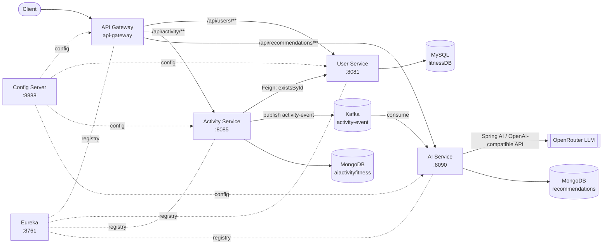
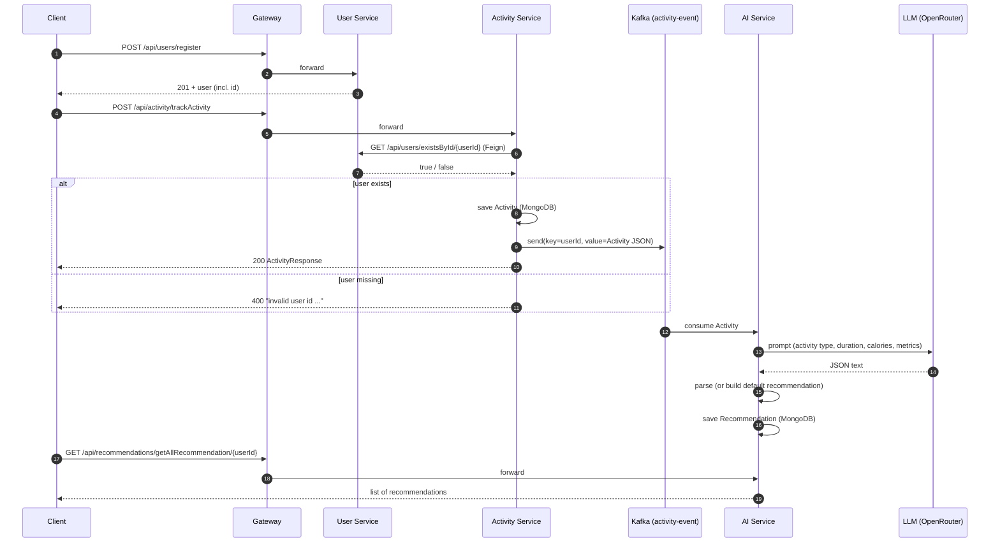
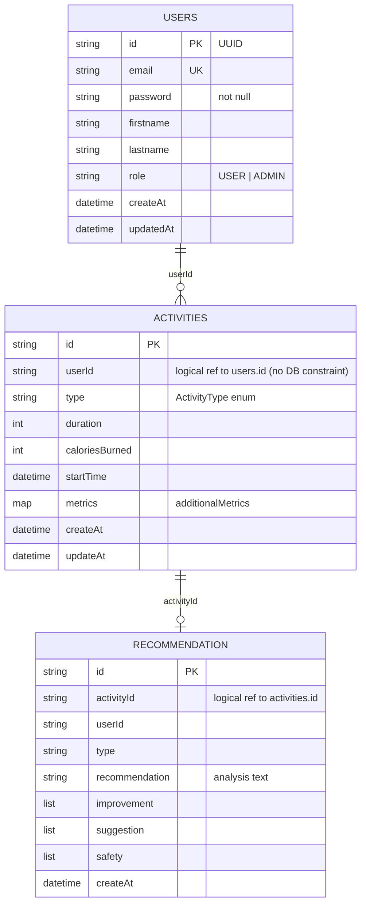

# AI Fitness Microservices Platform

A Spring Boot / Spring Cloud microservices backend for tracking fitness activities and generating AI-based workout recommendations. Users register, log activities, and each logged activity is sent through Kafka to an AI service that asks an LLM (via OpenRouter, using Spring AI's OpenAI client) for analysis and stores the result.

> **Status: work in progress (backend only).** The core flow (register user → track activity → Kafka → AI recommendation → fetch recommendation) is implemented in code. There is **no authentication, no frontend, no Docker/Kubernetes setup, no CI/CD pipeline, and no real automated tests yet**. See [Project Development Progress](#project-development-progress) and [Known Issues and Limitations](#known-issues-and-limitations).

> **How to read the status labels:** "Implemented" means the code exists in this repository. It does **not** mean the feature has been automated-tested or is production-ready. At the time this README was written, no feature in this repository had automated test coverage, and none should be considered production-ready.

---

## Table of Contents

1. [Project Overview](#project-overview)
2. [Problem Statement](#problem-statement)
3. [Project Objectives](#project-objectives)
4. [Key Features](#key-features)
5. [Technology Stack](#technology-stack)
6. [Project Development Progress](#project-development-progress)
7. [System Architecture](#system-architecture)
8. [Folder Structure](#folder-structure)
9. [Module-wise Explanation](#module-wise-explanation)
10. [Application Workflow](#application-workflow)
11. [Database Architecture](#database-architecture)
12. [API Documentation](#api-documentation)
13. [Installation and Setup](#installation-and-setup)
14. [Environment Configuration](#environment-configuration)
15. [Running the Project Locally](#running-the-project-locally)
16. [Docker, Kubernetes and CI/CD](#docker-kubernetes-and-cicd)
17. [Testing and Validation](#testing-and-validation)
18. [Known Issues and Limitations](#known-issues-and-limitations)
19. [Future Development Roadmap](#future-development-roadmap)
20. [Contributing](#contributing)
21. [License](#license)
22. [Author Information](#author-information)

---

## Project Overview

The platform is split into six independently runnable Spring Boot applications:

| Module                   | Role                                                                                              |
| ------------------------ | ------------------------------------------------------------------------------------------------- |
| `configserver`           | Spring Cloud Config Server (native profile) serving per-service YAML files from its own classpath |
| `eureka`                 | Netflix Eureka service registry                                                                   |
| `gateway`                | Spring Cloud Gateway: single entry point routing to the three business services                   |
| `userserviceApplication` | User registration and lookup, backed by MySQL                                                     |
| `activityservices`       | Activity tracking, backed by MongoDB; publishes events to Kafka                                   |
| `aiservices`             | Consumes activity events, calls an LLM, stores and serves recommendations in MongoDB              |

## Problem Statement

People who log workouts usually get raw numbers (duration, calories) with no interpretation. Giving personalised feedback on every logged activity would be slow to do manually, and doing it synchronously inside the "log activity" request would make that request slow and tightly coupled to an external AI provider.

## Project Objectives

- Separate user management, activity tracking, and AI processing into independent services.
- Decouple activity logging from AI analysis with an event stream (Kafka), so logging does not wait for the LLM.
- Centralise configuration (Config Server) and service discovery (Eureka), and expose one entry point (Gateway).
- Turn each logged activity into a structured recommendation: analysis, improvements, workout suggestions, and safety points.

## Key Features

Implemented in code (see the progress section for caveats):

- User registration with bean validation (email format, password length 6–15), persisted in MySQL via JPA.
- User listing, lookup by email, delete by email, and an existence check by user id.
- Activity tracking that first verifies the user exists (OpenFeign call to the user service), saves the activity to MongoDB, then publishes it to a Kafka topic.
- Kafka consumer in the AI service that builds a prompt, calls the LLM through Spring AI, parses the JSON answer, and saves a `Recommendation` document. If parsing fails, a generic default recommendation (with general safety tips) is saved instead.
- Endpoints to fetch all recommendations for a user, or the recommendation for a specific activity.
- Centralised configuration, Eureka service discovery, and gateway routing with load-balanced (`lb://`) routes.

## Technology Stack

Versions below are taken from the `pom.xml` files.

| Area               | Technology                                                                                                                             |
| ------------------ | -------------------------------------------------------------------------------------------------------------------------------------- |
| Language           | Java (`java.version` is **25** for config server, gateway, activity and AI services; **17** for Eureka and user service)               |
| Framework          | Spring Boot **4.0.5** (user, activity, AI, Eureka) and **3.5.0** (config server, gateway)                                              |
| Spring Cloud       | **2025.1.1** (user, activity, AI, Eureka) and **2025.0.0** (config server, gateway)                                                    |
| Service discovery  | Netflix Eureka (server + clients)                                                                                                      |
| Configuration      | Spring Cloud Config Server (native, files in `classpath:/config`)                                                                      |
| API gateway        | Spring Cloud Gateway (WebFlux), routes via `lb://`                                                                                     |
| Inter-service call | Spring Cloud OpenFeign (activity → user)                                                                                               |
| Messaging          | Apache Kafka via `spring-boot-starter-kafka`                                                                                           |
| AI                 | Spring AI **2.0.0-M4** (milestone release), `spring-ai-starter-model-openai`, pointed at OpenRouter; model `google/gemma-4-26b-a4b-it` |
| Databases          | MySQL (users, via Spring Data JPA / Hibernate); MongoDB (activities and recommendations, via Spring Data MongoDB)                      |
| Build              | Maven (a Maven Wrapper, `mvnw`, is in each module; Maven 3.9.14)                                                                       |
| Utilities          | Lombok, Spring Boot DevTools, Jakarta Bean Validation (user service)                                                                   |

## Project Development Progress

Legend: `[x]` implemented in code, `[~]` partly implemented, `[ ]` not implemented. Nothing here has been validated by automated tests.

### Completed

- [x] Config Server with native profile and per-service config files (`user-services`, `activity-services`, `ai-services`, `api-gateway`) — `configserver`
- [x] Eureka server (standalone, does not register with itself) — `eureka`
- [x] All business services and the gateway are Eureka clients (`@EnableDiscoveryClient`) and import config from `http://localhost:8888` (the import is `optional:`)
- [x] API Gateway routes for `/api/users/**`, `/api/activity/**`, `/api/recommendations/**`
- [x] User registration with validation and duplicate-email check; persisted in MySQL (`users` table, schema auto-update via Hibernate)
- [x] User list, delete-by-email, and exists-by-id endpoints
- [x] Activity tracking endpoint: validates user via Feign, saves to MongoDB, publishes to Kafka topic `activity-event`
- [x] Kafka consumer in the AI service (group `activity-proceser-group`) that triggers recommendation generation
- [x] LLM call through Spring AI (OpenRouter base URL), prompt construction, response parsing, and a default fallback recommendation
- [x] Recommendation storage in MongoDB and read endpoints (by user, by activity)

### Partially Completed

- [~] **Get user profile by email** — endpoint exists, but the repository query is hardcoded to a fixed email address, so it does not return the requested user (see [Known Issues](#known-issues-and-limitations)).
- [~] **Workout suggestions parsing** — code exists but reads fields from the wrong JSON node, so suggestions will not carry the AI's content.
- [~] **Security / credentials** — the user service stores and returns passwords in plain text; the MySQL password is committed in a config file. Only the AI API key is read from an environment variable.
- [~] **Error handling** — failures mostly surface as raw `RuntimeException` / default 500 responses; no global exception handler. Kafka publish errors are only printed.
- [~] **Gateway** — routes are defined, but no authentication, rate limiting, or explicit port is configured; the route-property format was not verified at runtime against the pinned Spring Cloud version.
- [~] **Activity service API** — only "track" exists; no read, update or delete endpoints.
- [~] **AI service MongoDB config** — both a connection URI and a separate `database` property are set with different database names; effective behaviour was not verified.
- [~] **Tests** — each module only has the auto-generated `contextLoads()` test. They have not been run as part of this documentation work and likely need the supporting infrastructure.

### Pending / Upcoming

- [ ] Authentication and authorization (the `UserRole` enum `USER`/`ADMIN` exists but is not used anywhere for access control)
- [ ] Password hashing
- [ ] Frontend / UI
- [ ] Meaningful unit and integration tests
- [ ] Dockerfiles and `docker-compose` for the services and their infrastructure (MySQL, MongoDB, Kafka)
- [ ] Kubernetes manifests
- [ ] CI/CD pipeline
- [ ] OpenAPI / Swagger documentation
- [ ] Global exception handling and consistent error responses
- [ ] Resilience for inter-service calls (timeouts, fallbacks, circuit breakers)
- [ ] Reliable event publishing (retry / outbox / dead-letter handling)
- [ ] Moving secrets out of committed config
- [ ] Activity read/update/delete and user update endpoints
- [ ] Observability (metrics, tracing, centralised logging)
- [ ] A `LICENSE` file

## System Architecture



Notes:

- The gateway's own `server.port` is not set in any config file in this repository, so Spring Boot's default (8080) would apply.
- The AI service's MongoDB database name is ambiguous in config (see [Database Architecture](#database-architecture)).

## Folder Structure

Each module is nested one level deeper than its name (for example `configserver/configserver`). Only files that exist in the repository are listed; `*Tests.java` files are the auto-generated `contextLoads` tests.

```text
.
├── README.md
├── configserver/configserver/
│   ├── pom.xml, mvnw, mvnw.cmd
│   └── src/main/
│       ├── java/com/fitness/configserver/ConfigserverApplication.java
│       └── resources/
│           ├── application.yml            # port 8888, native profile
│           └── config/
│               ├── activity-services.yml
│               ├── ai-services.yml
│               ├── api-gateway.yml
│               └── user-services.yml
├── eureka/eureka/
│   └── src/main/{java/com/fitness/eureka/EurekaApplication.java, resources/application.yml}
├── gateway/gateway/
│   └── src/main/{java/com/fitness/gateway/GatewayApplication.java, resources/application.yml}
├── userserviceApplication/userserviceApplication/
│   └── src/main/java/com/fitness/userserviceApplication/
│       ├── UserserviceApplication.java
│       ├── controller/userController.java
│       ├── services/userServices.java
│       ├── Repository/UserRepository.java
│       ├── models/{User.java, UserRole.java}
│       └── dto/{RegisterRequest.java, UserResponse.java}
├── activityservices/activityservices/
│   └── src/main/java/com/fitness/activityservices/
│       ├── ActivityservicesApplication.java
│       ├── controller/ActivityController.java
│       ├── service/ActivityService.java
│       ├── repository/ActivityRepository.java
│       ├── model/{Activity.java, ActivityType.java}
│       ├── dto/{ActivityRequest.java, ActivityResponse.java}
│       └── config/{FeignClient.java, MongoConfig.java}
└── aiservices/aiservices/
    └── src/main/java/com/fitness/aiservices/
        ├── AiservicesApplication.java
        ├── controller/RecommendationController.java
        ├── services/{ActivityMessageListener.java, ActivityAiProcessServices.java,
        │             OpenAiServices.java, RecommendationServices.java}
        ├── prompt/Prompt.java
        ├── RecommendationRepository/AiRepository.java
        ├── model/{Activity.java, ActivityType.java, Recommendation.java}
        └── config/MongoConfig.java
```

## Module-wise Explanation

**configserver** (port 8888) — Runs `@EnableConfigServer` with `spring.profiles.active=native`, serving YAML from `classpath:/config`. The files are named after each client's `spring.application.name`.

**eureka** (port 8761) — `@EnableEurekaServer`. `register-with-eureka` and `fetch-registry` are both `false`. It does not import config from the Config Server.

**gateway** — `@EnableDiscoveryClient` app whose routes come from the Config Server's `api-gateway.yml`:

| Route id            | Path predicate            | Target                   |
| ------------------- | ------------------------- | ------------------------ |
| `user-service`      | `/api/users/**`           | `lb://user-services`     |
| `activity-services` | `/api/activity/**`        | `lb://activity-services` |
| `ai-services`       | `/api/recommendations/**` | `lb://ai-services`       |

Gateway debug logging (`org.springframework.cloud.gateway: DEBUG`) is enabled in that file.

**userserviceApplication** (port 8081, registered as `user-services`) — `userController` → `userServices` → `UserRepository` (JPA). Entity `User` has UUID id, unique email, password, first/last name, `role` (default `USER`), and created/updated timestamps. Native SQL is used for existence check, lookup by email, and delete.

**activityservices** (port 8085, registered as `activity-services`) — `ActivityController.trackActivity` calls `ActivityService.ifExistUser` (Feign client to `user-services`, `GET /api/users/existsById/{id}`). If the user exists it saves an `Activity` to the `activities` collection and sends it to Kafka (key = userId, value = JSON). `@EnableMongoAuditing` fills `createAt`/`updateAt`.

**aiservices** (port 8090, registered as `ai-services`) —

- `ActivityMessageListener` consumes the topic (`groupId = activity-proceser-group`).
- `Prompt` builds a prompt asking for a fixed JSON structure (analysis, improvement, suggestions, safety).
- `OpenAiServices` sends it through a Spring AI `ChatClient`.
- `ActivityAiProcessServices` strips code fences, parses the JSON with Jackson, maps it to a `Recommendation`, and falls back to a default recommendation on any exception.
- `RecommendationServices` / `RecommendationController` read saved recommendations from MongoDB.

## Application Workflow



Recommendation generation is asynchronous, so a recommendation will not exist immediately after `trackActivity` returns.

## Database Architecture

Two database technologies are used. There is no shared database between services.



| Store                       | Service          | Where configured                                           | Collection / table |
| --------------------------- | ---------------- | ---------------------------------------------------------- | ------------------ |
| MySQL `fitnessDB`           | user service     | `user-services.yml` (`ddl-auto: update`, `show-sql: true`) | `users`            |
| MongoDB `aiactivityfitness` | activity service | `activity-services.yml` (host `localhost`, port `27017`)   | `activities`       |
| MongoDB (see note)          | AI service       | `ai-services.yml`                                          | `recommendation`   |

`ActivityType` values: `RUNNING, WALKING, CYCLING, SWIMMING, WEIGHT_TRAINING, YOGA, CARDIO, STRETCHING, OTHER`.

Note: `ai-services.yml` sets `spring.data.mongodb.uri` to a database named `aifitnessrecommendation` **and** `spring.data.mongodb.database` to `fitnessrecommendation`. Which one wins was not verified; align them before relying on it.

## API Documentation

All paths below are served by the owning service directly and through the gateway (same path). No endpoint requires authentication. There is no OpenAPI/Swagger documentation in the project.

### User service (`/api/users`)

| Method | Path                           | Description                                                                                       | Result                                                                         |
| ------ | ------------------------------ | ------------------------------------------------------------------------------------------------- | ------------------------------------------------------------------------------ |
| POST   | `/register`                    | Body: `email` (required, valid email), `password` (required, 6–15 chars), `firstname`, `lastname` | 201 with user data. Duplicate email throws a `RuntimeException` (generic 500). |
| GET    | `/find-all-user`               | List all users (returns the entity, including the password field)                                 | 200                                                                            |
| GET    | `/getUserProfileEmail/{email}` | Intended: fetch a user by email                                                                   | 200 — **buggy, see Known Issues**                                              |
| GET    | `/deleteUserByEmail/{email}`   | Delete a user by email (uses GET)                                                                 | 200 with `"DELETE SUCCESSFULLY"` or `"Email Dose Not Exit"`                    |
| GET    | `/existsById/{userid}`         | Boolean existence check (used by the activity service)                                            | 200 `true` / `false`                                                           |

### Activity service (`/api/activity`)

| Method | Path             | Description                                                                                                                         | Result                                                                         |
| ------ | ---------------- | ----------------------------------------------------------------------------------------------------------------------------------- | ------------------------------------------------------------------------------ |
| POST   | `/trackActivity` | Body: `userId`, `type` (`ActivityType`), `duration`, `caloriesBurned`, `startTime` (ISO local date-time), `additionalMetrics` (map) | 200 with saved activity; 400 with a text message if the user id does not exist |

### AI service (`/api/recommendations`)

| Method | Path                                        | Description                     | Result                                                          |
| ------ | ------------------------------------------- | ------------------------------- | --------------------------------------------------------------- |
| GET    | `/getAllRecommendation/{userId}`            | All recommendations for a user  | 200, list (may be empty)                                        |
| GET    | `/getParticulerRecommendation/{activityId}` | Recommendation for one activity | 200; throws `RuntimeException` (generic 500) if none exists yet |

`Recommendation` fields: `id, activityId, userId, type, recommendation, improvement[], suggestion[], safety[], createAt`.

### Example requests (via the gateway)

The gateway port is not configured, so 8080 (Spring Boot default) is assumed; adjust if you set one.

```bash
# 1. Register
curl -X POST http://localhost:8080/api/users/register \
  -H "Content-Type: application/json" \
  -d '{"email":"jane@example.com","password":"secret123","firstname":"Jane","lastname":"Doe"}'

# 2. Track an activity (use the "id" returned above as userId)
curl -X POST http://localhost:8080/api/activity/trackActivity \
  -H "Content-Type: application/json" \
  -d '{"userId":"<USER_ID>","type":"RUNNING","duration":30,"caloriesBurned":300,"startTime":"2026-01-01T07:00:00","additionalMetrics":{"distanceKm":5}}'

# 3. Fetch recommendations (after a few seconds)
curl http://localhost:8080/api/recommendations/getAllRecommendation/<USER_ID>
```

## Installation and Setup

### Prerequisites

- **JDK 25** (the config server, gateway, activity service and AI service declare `java.version` 25; the user service and Eureka declare 17, which JDK 25 also satisfies).
- **MySQL** on `localhost:3306` with a database named `fitnessDB` created in advance (the JDBC URL has no create-if-missing option).
- **MongoDB** on `localhost:27017`.
- **Apache Kafka** broker on `localhost:9092`. No topic is declared in code, so the topic `activity-event` must be auto-created by the broker or created manually.
- An **OpenRouter** (or other OpenAI-compatible) API key for the AI service.
- Maven is not required globally; each module has `mvnw`/`mvnw.cmd`.

### Clone

```bash
git clone https://github.com/devrajesh755/ai-fitness-microservices-platform.git
cd ai-fitness-microservices-platform
```

## Environment Configuration

All service settings come from the Config Server files in `configserver/configserver/src/main/resources/config/`. Each service only holds its name and the config import in its own `application.yml`.

| Setting              | Where                                      | Value in repo                                                                              |
| -------------------- | ------------------------------------------ | ------------------------------------------------------------------------------------------ |
| Config server URL    | each service's `application.yml`           | `http://localhost:8888`                                                                    |
| Eureka URL           | each `*.yml` config                        | `http://localhost:8761/eureka/`                                                            |
| Ports                | per-service config                         | user 8081, activity 8085, AI 8090, config 8888, Eureka 8761; gateway not set               |
| MySQL                | `user-services.yml`                        | `jdbc:mysql://localhost:3306/fitnessDB`, user `root`, password **committed in plain text** |
| Activity MongoDB     | `activity-services.yml`                    | `localhost:27017`, db `aiactivityfitness`                                                  |
| Kafka topic          | `activity-services.yml`, `ai-services.yml` | `activity-event`                                                                           |
| Kafka brokers        | `ai-services.yml`                          | `localhost:9092` (activity service sets none, so Spring Boot's default applies)            |
| LLM key              | `ai-services.yml`                          | read from environment variable **`OPEN_API_KEY`**                                          |
| LLM endpoint / model | `ai-services.yml`                          | `https://openrouter.ai/api`, `google/gemma-4-26b-a4b-it`                                   |

Required before running the AI service:

```bash
export OPEN_API_KEY=<your-openrouter-api-key>      # Linux / macOS
# PowerShell:  $env:OPEN_API_KEY="<your-openrouter-api-key>"
```

> **Security note:** `user-services.yml` contains the MySQL root password in plain text. Change it to match your own local MySQL, and move it to an environment variable or secret store before sharing or deploying. Consider rotating it if it was ever used elsewhere. Never commit your API key.

## Running the Project Locally

Start infrastructure first (MySQL with `fitnessDB`, MongoDB, Kafka), then start the services **in this order**, each in its own terminal. Config Server and Eureka should be up before the others, because the other services read their port, database and Eureka settings from the Config Server (the import is `optional:`, so a service started without it will not fail at the import but will run with defaults and no database/Eureka config).

```bash
# 1. Config Server (8888)
cd configserver/configserver && ./mvnw spring-boot:run

# 2. Eureka (8761)
cd eureka/eureka && ./mvnw spring-boot:run

# 3. User service (8081)
cd userserviceApplication/userserviceApplication && ./mvnw spring-boot:run

# 4. Activity service (8085)
cd activityservices/activityservices && ./mvnw spring-boot:run

# 5. AI service (8090) — needs OPEN_API_KEY set in this shell
cd aiservices/aiservices && ./mvnw spring-boot:run

# 6. Gateway
cd gateway/gateway && ./mvnw spring-boot:run
```

These commands follow the Maven Wrapper layout and Spring Boot plugin present in each `pom.xml`; the full stack has not been started end-to-end as part of writing this README. On Windows use `mvnw.cmd spring-boot:run`. Eureka dashboard: `http://localhost:8761`.

## Docker, Kubernetes and CI/CD

None of these exist in the repository yet: no `Dockerfile`, no `docker-compose.yml`, no Kubernetes manifests, and no CI/CD workflow files. They are listed under the [roadmap](#future-development-roadmap). Because of this, the service URLs in the config (`localhost`) would also need to be externalised before containerising.

## Testing and Validation

- Each of the six modules contains only the Spring Initializr-generated `contextLoads()` test (`@SpringBootTest`).
- There are no unit tests, controller tests, Kafka tests, or integration tests.
- The Maven test dependencies for MongoDB, Kafka and WebMVC are declared but not used by any custom test.
- The tests were not executed as part of writing this README, and as plain `@SpringBootTest` classes they may need the surrounding infrastructure to pass.

To run them yourself: `./mvnw test` inside a module directory.

## Known Issues and Limitations

Found by reading the code; not all have been reproduced at runtime.

**Correctness**

1. `UserRepository.getUserByEmail` has a hardcoded email in its SQL (`WHERE email = 'user4@gmail.com'`) and ignores its parameter, so `GET /getUserProfileEmail/{email}` returns the wrong user (or none) for any other email.
2. `ActivityAiProcessServices.extractSuggestion` calls `suggestionNode.path("workout")` / `path("description")` on the array instead of on each element, so AI workout suggestions will not be captured as intended.
3. The prompt in `Prompt.java` has a stray quote in the JSON example and a misspelled key (`heartRete`), and the parser looks for the same misspelled key. The analysis sections are concatenated without a separator after the label (e.g. `Overall` immediately followed by the text).
4. `extractSafety` returns a list containing one empty string when the AI gives no safety items.
5. If the AI response lacks an `analysis` node (or any parsing step throws), the exception is caught and the generic default recommendation is stored, so the real answer is silently lost.

**Security** 6. No authentication or authorization anywhere; all endpoints are open, including `find-all-user` and delete. 7. Passwords are stored in plain text, and are returned in the registration response and by `find-all-user`. 8. The MySQL password is committed in `user-services.yml`. 9. Deleting a user is done with `GET`.

**Reliability / design** 10. `trackActivity` saves the activity and then publishes to Kafka; a publish failure is only printed to the console, so an activity can exist with no recommendation and no retry. 11. The Feign call to the user service has no fallback or timeout configuration; if the user service is down, the request fails with an unhandled error. 12. Missing recommendation, duplicate email, and other failures throw plain `RuntimeException`s with no global exception handler. 13. Recommendations are generated asynchronously, so clients must poll; there is no status endpoint. 14. No validation annotations on `ActivityRequest`. 15. Services use mixed Java versions (25 / 17), mixed Spring Boot versions (4.0.5 / 3.5.0), and Spring AI is a **milestone** release (`2.0.0-M4`). 16. The gateway route keys use the `spring.cloud.gateway.server.webflux.routes` prefix, while the gateway module is pinned to Spring Cloud `2025.0.0` / Boot `3.5.0`. This combination was not verified at runtime. 17. The AI service has conflicting MongoDB database names in its config (see [Database Architecture](#database-architecture)). 18. Local-only setup: all hosts are `localhost`, and a `.idea/` folder is tracked in the repository.

## Future Development Roadmap

Higher priority first:

1. Fix the correctness bugs above (profile query, suggestion parsing, prompt keys).
2. Add authentication (e.g. Spring Security with JWT at the gateway), hash passwords, stop returning them, and move credentials out of committed config.
3. Add a global exception handler and request validation for activities.
4. Add real unit and integration tests (e.g. Testcontainers for MySQL, MongoDB and Kafka).
5. Add Docker images and a `docker-compose` file for local development.
6. Add Kubernetes manifests and a CI/CD pipeline.
7. Add activity read/update/delete endpoints and user update; use `DELETE` for deletion.
8. Add resilience (timeouts, circuit breaker, Kafka retry / dead-letter handling).
9. Add OpenAPI documentation and observability.
10. Add a frontend.
11. Align Java / Spring Boot / Spring Cloud versions across modules and move off the Spring AI milestone when a stable release is available.

## Contributing

Contributions are welcome. Open an issue to discuss a change, fork the repository, make your change on a branch, and open a pull request. Please do not commit secrets or API keys. Because there is no automated test suite yet, describe how you verified your change in the pull request.

## License

No `LICENSE` file is present in this repository, so no license is currently granted. Add one before accepting external contributions or reuse.

## 👨‍💻 Author

**Rajesh Manik**  
Java Backend Developer | Spring Boot Developer | DevOps Enthusiast

- **GitHub:** https://github.com/devrajesh755
- **LinkedIn:** https://www.linkedin.com/in/rajesh-manik-11476528a/
- **Email:** rajeshmanik721211@gmail.com
- **Location:** Barasat, West Bengal, India – 700124

Feel free to connect with me for collaboration, technical discussions, and professional opportunities.
